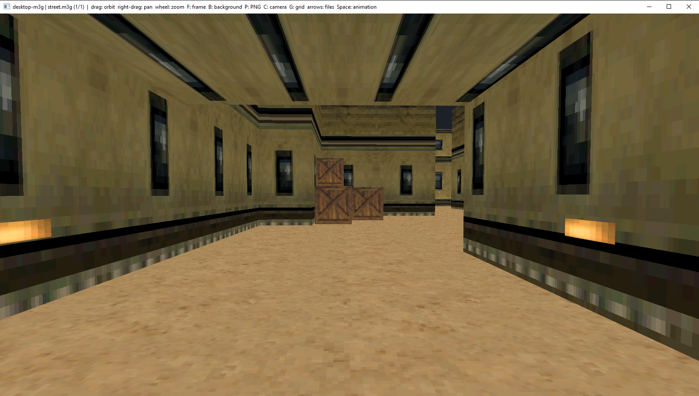
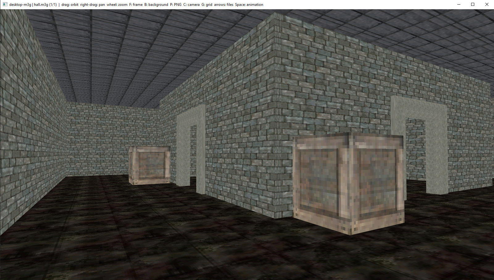

# Desktop-M3G

A C++ implementation of the Mobile 3D Graphics API, originally developed for Java ME devices. 

<p align="center">


</p>

## Features
- M3G 1.1 file loading
- Skeletal animation
- Materials and textures

## Getting started
### Requirements
- C++17
- CMake 3.21+
- OpenGL 1.5+
- zlib

### Building
```bash
git clone https://github.com/Kolyah35/desktop-m3g.git
cd desktop-m3g

cmake -S . -B build -DBUILD_SAMPLES=OFF
cmake --build build --config Release
```

### Integration
Get [CPM.cmake](https://github.com/cpm-cmake/cpm.cmake)

```cmake
CPMAddPackage("gh:Kolyah35/desktop-m3g#master")

target_link_libraries(${PROJECT_NAME} m3g)
```

See [examples](./sample/)

## Credits
Based on the original Desktop-M3G project by UEDA Takashi, with subsequent community improvements.